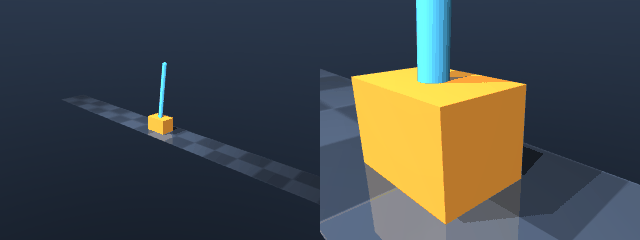

<p align="center"></p>

# qddot (q̈, joint acceleration)

**Playwright for robot code:** run, check, and debug robot controllers in physics before an agent claims the task is done.

[](https://pypi.org/project/qddot/)
[](LICENSE)
[](https://www.python.org/)

## Why qddot

- Coding agents are strongest when they can execute code and check its result.
- Robot code cannot be verified by reading it: frames, signs, timing, contacts, and dynamics all matter.
- In RobotWorld's October 2026 report, the leading model completed 16 of 84 tasks (19%); some failures included reporting unfinished tasks as complete. [RobotWorld report](https://huggingface.co/papers/2610.10409). CaP-X reports that multi-turn execution feedback and visual differencing can improve coding-agent robustness. [CaP-X paper](https://arxiv.org/abs/2603.22435)

qddot gives a coding agent a local simulation loop with measurable specifications, recorded signals, event diagnosis, and seeded perturbation runs. Sim results are evidence about the model and task you supplied, not a certificate for hardware.

## 30-second demo

This transcript was captured by running qddot 0.1.0 from a temporary project directory with the bundled cart-pole task (seed 0). Episode IDs and reported paths are the actual CLI output.

```text
$ qddot run tasks/cartpole_balance/task.yaml --controller tasks/cartpole_balance/controllers/buggy_velocity_sign.py --seed 0
FAIL cartpole_balance  robustness -1.748  episode cartpole_balance-buggy_velocity_sign-s0-94cfad
  upright_and_hold     FAIL  rob -1.748  worst at t=2.29s (window 0.00-2.00s)
  stay_on_rail         FAIL  rob -0.237  worst at t=1.24s (window 0.00-4.00s)
  avoid_saturation     FAIL  rob -0.500  worst at t=0.15s (window 0.00-4.00s)
  events: contact_start x6 (first floor @0.00s), contact_end x4 (first floor @0.52s), slip x4 (first floor @0.02s)
  why: tracking error grows from the start; check sign or coordinate frame [med]
  files: .qddot/runs/cartpole_balance-buggy_velocity_sign-s0-94cfad/  (signals.parquet events.parquet verdict.json log.mcap)
  next: qddot query "select ..." | qddot fuzz ...

$ qddot why .qddot/runs/cartpole_balance-buggy_velocity_sign-s0-94cfad
FAIL episode cartpole_balance-buggy_velocity_sign-s0-94cfad
first failing spec: upright_and_hold at 2.29s window 0.00-2.00s
  within 2 s, |joint.pole.pos| drops below 0.05 and stays there for 2 s
joint.pole.pos: -1.798 (window -1.819..0.1), falling
first events: slip floor @0.022s; saturation push @0.140s; contact_end floor @0.524s; joint_limit cart @0.526s
likely causes: tracking error grows from the start; check sign or coordinate frame [med]; joint range was reached [high]
  evidence: diverging signal(s): joint.pole.pos; saturation began at 0.140s
  evidence: joint_limit on cart at 0.526s
next: qddot query "select t, \"joint.pole.pos\" from signals where episode = 'cartpole_balance-buggy_velocity_sign-s0-94cfad' order by t limit 20"
next: qddot replay .qddot/runs/cartpole_balance-buggy_velocity_sign-s0-94cfad --at 2.290

# Fix: use the correctly signed angular velocity in the state feedback.
$ qddot run tasks/cartpole_balance/task.yaml --controller tasks/cartpole_balance/controllers/good.py --seed 0
PASS cartpole_balance  robustness 0.044  episode cartpole_balance-good-s0-94cfad
  upright_and_hold     PASS  rob 0.044  worst at t=2.76s (window 0.00-2.00s)
  stay_on_rail         PASS  rob 0.594  worst at t=1.04s (window 0.00-4.00s)
  avoid_saturation     PASS  rob 0.500  worst at t=0.00s (window 0.00-4.00s)
  events: slip x2 (first floor @0.02s), contact_start x1 (first floor @0.00s)
  files: .qddot/runs/cartpole_balance-good-s0-94cfad/  (signals.parquet events.parquet verdict.json log.mcap)
  next: qddot query "select ..." | qddot fuzz ...

$ qddot fuzz tasks/cartpole_balance/task.yaml --controller tasks/cartpole_balance/controllers/good.py -n 50 --workers 1 --seed 0
fuzz: 50/50 passed  pass rate 100.0%
  cartpole_balance-good-s17-4c132b  robustness 0.044
  cartpole_balance-good-s46-31c3da  robustness 0.044
  cartpole_balance-good-s31-eb2c42  robustness 0.044
  cartpole_balance-good-s42-366e1e  robustness 0.044
  cartpole_balance-good-s10-3dfd4e  robustness 0.044
  most correlated: controller_budget_ms (pass_corr n/a)
```

This task's observed fuzz result is 100% (50/50), not a target result. Results depend on the exact task, controller, dependencies, MuJoCo version, and machine.



## Install

Python 3.12+ is required. With [uv](https://docs.astral.sh/uv/):

From a source checkout:

```sh
uv sync
uv run qddot --help
```

PyPI publication is pending. Once published, install the CLI with uv or pip:

```sh
uv tool install qddot
python -m pip install qddot
```

## Quickstart

```sh
qddot check tasks/cartpole_balance/model.xml
qddot spec tasks/cartpole_balance/task.yaml
qddot run tasks/cartpole_balance/task.yaml \
  --controller tasks/cartpole_balance/controllers/good.py --seed 0
qddot why .qddot/runs/cartpole_balance-good-s0-94cfad
qddot fuzz tasks/cartpole_balance/task.yaml \
  --controller tasks/cartpole_balance/controllers/good.py -n 50
```

See [Quickstart](docs/quickstart.md) for installation from a checkout and a complete workflow.

## For coding agents

Install the workflow instructions for your agent, or use the stdio MCP server:

```sh
qddot skill install --claude
qddot skill install --codex
qddot mcp
```

The workflow is: inspect the task and its English spec read-back; run the controller; use `why`, SQL queries, and `replay` to diagnose failures; fix and rerun; fuzz at least 50 seeded perturbations. Report a PASS episode ID and fuzz pass rate. See [Agents](docs/agents.md).

## Concepts

- **Tasks** define a MuJoCo model, initial state, controller period, derived signals, perturbations, and requirements.
- **Controllers** are Python files with `Controller.step(obs, t)` and optional `reset(info)`.
- **Specs** are Signal Temporal Logic (STL) formulas. Robustness gives a signed margin; the witness and window point to the sample and temporal interval that determined it.
- **Events** record meaningful transitions such as contact, joint limits, saturation, and deadline misses.
- **Fuzz** repeats runs with reproducible physical and observation perturbations.
- **Diagnosis** explains a failed spec (`why`), compares episodes (`diff`), re-simulates recorded controls (`replay`), and renders an offline GIF/HTML report (`view`).
- **Memory** indexes episode failure cards (`remember`) and retrieves related failures (`similar`).

## Commands

| Command | Purpose |
|---|---|
| `qddot run TASK --controller FILE` | Run a controller and write an episode |
| `qddot fuzz TASK --controller FILE [-n N] [--workers W] [--seed N]` | Run seeded perturbations |
| `qddot check MODEL` | Static MuJoCo model checks |
| `qddot spec TASK` | List STL requirements and English read-backs |
| `qddot why EPISODE [--frames] [--vlm]` | Diagnose the first failing spec |
| `qddot diff A B [--tolerance FLOAT]` | Compare signals, events, specs, and metadata |
| `qddot replay EPISODE --at T [--frame]` | Re-simulate and inspect state at time T |
| `qddot view EPISODE [--open]` | Create an offline replay GIF and HTML report |
| `qddot query SQL [--root DIR] [--limit N] [--json]` | Query episode views with DuckDB |
| `qddot runs [--last N] [--root DIR]` | List recent episodes |
| `qddot remember [EPISODE] [--all] [--global]` | Index failure cards |
| `qddot similar EPISODE [-k N] [--global]` | Find related recorded failures |
| `qddot skill install [--claude\|--codex\|--project]` | Install agent workflow instructions |
| `qddot mcp` | Serve tools over MCP stdio |

Use `--json` where supported for machine-readable output. Full options and real transcripts are in [CLI reference](docs/cli.md).

## How qddot fits

Log tools such as [Foxglove](https://foxglove.dev/) and [bagel](https://github.com/foxglove/bagel) help inspect and query recorded robotics data; [Roboto](https://github.com/robotics) and similar stacks focus on observability. qddot focuses on running a controller against a task's simulator and formal requirements, then retaining replayable signals and events.

[OmniSim](https://github.com/OmniGibson/OmniGibson) is a simulation environment for embodied agents. qddot takes a smaller, local workflow approach around MuJoCo task files, controller code, STL verdicts, deterministic replay, comparison, and perturbation fuzzing.

RL benchmarks measure learning or policy performance over benchmark-defined environments and metrics. qddot evaluates ordinary controller code against task-authored specs and exposes episode evidence for debugging. It is not an RL training suite.

## Benchmark

The separate `bench/` harness compares coding-agent conditions (`none`, `stdout`, `qddot`, and `qddot_memory`) on public and held-out tasks. It grades nominal behavior, hidden-seed fuzz robustness, control metrics, and false-done claims. Every trial gets a fresh workdir; reference controllers and hidden failure notes are withheld. The current `qddot_memory` condition is reserved and receives the same tools as `qddot`. **Benchmark results coming soon.** See [Benchmark](docs/benchmark.md) and [bench/README.md](bench/README.md).

## Performance

Everything runs locally and fast enough to sit inside an agent's edit-run loop.

Measured with `python -m bench.perf` on arm64 15.7.7, 10 cores, MuJoCo 3.15.0, median of 3 runs.

| Task | DoF | Sim time | Wall time | Real-time factor | Physics steps/s |
|---|---:|---:|---:|---:|---:|
| aloha_transfer_cube | 22 | 6.0 s | 0.45 s | 13x | 6,718 |
| cartpole_balance | 2 | 4.0 s | 0.08 s | 48x | 23,917 |
| diffdrive_waypoints | 5 | 6.0 s | 0.11 s | 57x | 28,296 |
| double_pendulum_lqr | 2 | 4.0 s | 0.03 s | 118x | 58,918 |
| joint_pid_payload | 1 | 4.0 s | 0.02 s | 168x | 84,100 |
| latency_servo | 1 | 3.3 s | 0.02 s | 133x | 132,729 |
| repair_arm_model | 2 | 3.0 s | 0.02 s | 152x | 76,192 |
| repair_gripper_model | 9 | 3.0 s | 0.09 s | 35x | 17,275 |
| so101_box_push | 12 | 4.5 s | 0.37 s | 12x | 2,458 |
| so101_line_trace | 12 | 3.5 s | 0.11 s | 32x | 6,414 |
| so101_reach | 6 | 4.0 s | 0.07 s | 57x | 11,307 |
| ur5e_cartesian_reach | 6 | 5.0 s | 0.06 s | 78x | 38,945 |
| ur5e_obstacle_avoid | 6 | 5.5 s | 0.08 s | 69x | 34,323 |
| ur5e_payload_hold | 6 | 5.0 s | 0.06 s | 81x | 40,615 |
| ur5e_track | 6 | 4.0 s | 0.04 s | 91x | 45,438 |
| wheeled_balancer | 4 | 5.0 s | 0.07 s | 67x | 33,499 |

| Command | Latency |
|---|---:|
| `qddot --help (startup)` | 0.19 s |
| `run (4 s cart-pole episode)` | 0.41 s |
| `why` | 0.30 s |
| `why --frames` | 0.67 s |
| `query (events by kind)` | 0.17 s |
| `diff` | 0.31 s |
| `fuzz -n 20 (all cores)` | 1.25 s |
| `similar (warm memory)` | 0.58 s |
| `view (GIF + HTML)` | 0.96 s |

Reproduce with `python -m bench.perf`. Details: [docs/performance.md](docs/performance.md).

## Limitations

- “Sim-checked” does not mean verified on hardware. Friction, contact, and grasping fidelity are limited by the supplied model and MuJoCo configuration.
- MuJoCo determinism is expected only for the same version and platform; it is not a cross-platform bitwise guarantee.
- Deadline modeling uses measured wall-clock controller compute time, which varies with machine load.
- Firmware execution and real-time firmware/timing emulation are not supported yet.

More detail: [Limitations](docs/limitations.md).

## Roadmap

Planned directions include a ROS 2 adapter, Isaac and Newton backends, Renode firmware co-simulation, WASM shareable replays, and Yantra RL environments. These are roadmap items, not current capabilities.

## Contributing

See [CONTRIBUTING.md](CONTRIBUTING.md). qddot is Apache-2.0 licensed; see [LICENSE](LICENSE).
